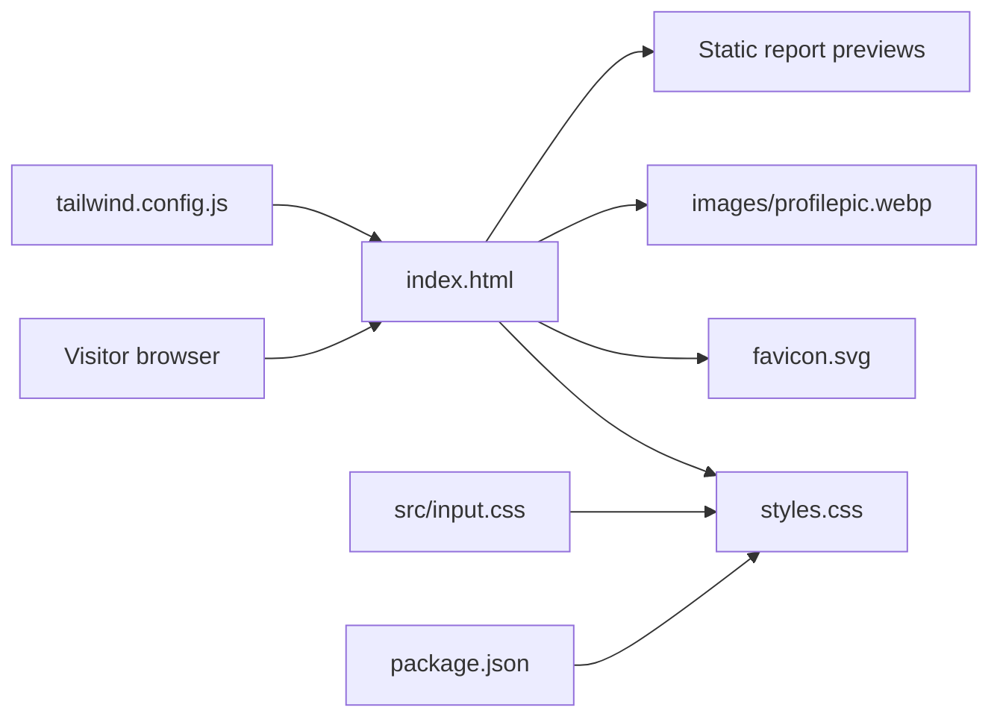

# Personal Portfolio Website

Source for [rishabhjain9196.github.io](https://rishabhjain9196.github.io), a responsive single-page portfolio website.


## Overview

The site is a static page built with HTML, CSS and vanilla JavaScript, and served by GitHub Pages. The introduction leads to professional experience, followed by independent and team project reports, writing, education and mentoring. Earlier projects have a horizontal browsing row. Awards and recognition is a separate section with rows for industry and hackathons, and competitive programming.

Professional descriptions focus on personal contributions within product teams. Product-wide usage totals are not presented as personal achievements. Independent project tools and current study are distinguished from production experience.

## Structure



| Path | Purpose |
| --- | --- |
| `index.html` | Main single-page portfolio content, navigation, sections and client-side interaction. |
| `styles.css` | Checked-in stylesheet used by the page. |
| `src/input.css` | Tailwind directives and the authored theme, layout and responsive styles. |
| `tailwind.config.js` | Tailwind configuration that scans `index.html` and enables class-based light mode styling. |
| `package.json` | Defines Tailwind build and watch scripts. |
| `favicon.svg` | Site icon. |
| `images/profilepic.webp` | Compressed portrait used in the page. The original PNG is retained as the source. |
| `images/delhi-preview.webp` | Static preview of the Delhi report's road-speed map. |
| `images/rag-preview.svg` | Editable illustration of contract selection, scoped retrieval and an answer with source references. |
| `images/rag-preview.webp` | Compressed version of the RAG workflow illustration used on the project card. |
| `images/taxi-preview.webp` | Static preview of the NYC report's taxi-zone map. |
| `images/heatmap-preview.webp` | Static preview of the synthetic workforce heatmap, including map attribution. |
| `reports/workforce-heatmap-2019/` | Self-contained copy of the 2019 team project's visual report. |
| `resume/` | Unlinked redirect to the approved PDF, displayed by the browser's PDF viewer. |
| `images/og-preview.svg` | Editable source for the 1200 by 630 social preview. |
| `images/og-preview.png` | PNG social preview used by Open Graph and Twitter metadata. |
| `images/logos/` | Local company, university and contest marks. Source links are listed below. |

## Features

- Responsive desktop and mobile navigation.
- Sticky navigation, with six section links.
- Static report thumbnails, with no chart-library dependency on the homepage.
- Inter and JetBrains Mono typography, with system fallbacks while Google Fonts loads.
- Blue and cyan gradient headings, soft animated background glows, a framed portrait and accented experience cards.
- Scroll-reveal effects on below-the-fold content and subtle card hover effects.
- Light and dark themes, with the choice saved in `localStorage`.
- The menu supports Escape, focus return and accessible expanded-state announcements.
- Content and navigation remain available without JavaScript.
- Horizontal project and award rows support native scrolling, touch swipes, previous/next buttons and Left/Right, Home and End keys when the row has focus.
- Rows do not autoplay. Buttons indicate boundaries without losing keyboard focus. Native scrolling remains available without JavaScript.
- Education and earlier roles include locally served logos. Light logo backgrounds preserve the original brand colours in either theme.
- Experience pairs company marks with Azure SQL Database, Microsoft Teams, Google Docs, Sheets and Slides product icons. Descriptions follow the supplied resume and retain previously confirmed Teams caching and API contributions. Product-wide scale is not presented as personal output.
- Experience, mentoring and recognition use action-led wording rather than sentences starting with "I".
- Eight section headings have compact, theme-aware inline SVG icons. These are decorative section markers, not organisation logos. They require no image requests and are hidden from assistive technology.
- Earlier-project cards are capped at 310 pixels wide. Industry award cards are capped at 300 pixels, and programming awards at 240 pixels. Compact logo rows and inline result labels reduce height without hiding descriptions. Scroll controls disappear when every card fits.
- Featured reports retain their full text and uncropped previews, with thumbnail height capped at 180 pixels on larger screens and 156 pixels on phones.
- Content is visible by default, including without JavaScript or `IntersectionObserver`. Only eligible below-the-fold elements are hidden for a reveal.
- Keyboard focus and direct section links reveal their targets immediately. Reduced-motion preferences disable animations and smooth scrolling, and reveal any pending content when the preference changes.

## Search metadata

- The homepage includes `ProfilePage` and `Person` structured data using public career and profile details. Update it when the visible role changes.
- The homepage and workforce report have canonical URLs and social-preview metadata. Keep the workforce report metadata synchronised with its source repository.
- `sitemap.xml` lists the homepage and four published reports on this hostname, including reports deployed from separate repositories. Update it when public report URLs change.
- `robots.txt` allows crawling except for the resume PDF and points to the sitemap. Neither file guarantees indexing or ranking.
- After publishing, verify the site in Google Search Console, submit the sitemap and inspect the listed URLs. Account verification must be completed by the site owner; no placeholder verification token is included.

## Unlinked resume PDF

- `/resume` resolves to `/resume/`, which immediately redirects to `/resume/resume.pdf` without JavaScript. The browser's PDF viewer displays the actual document; browser preferences may instead trigger a download.
- The redirect includes a direct PDF link as a fallback. There is no separate HTML resume or `download` attribute.
- Do not add this route to homepage navigation, project cards or `sitemap.xml`.
- The HTML requests `noindex, nofollow, noarchive`. Crawlers must be allowed to fetch the HTML to see these directives; only the PDF is disallowed in `robots.txt`.
- These controls are not authentication and do not guarantee secrecy or exclusion from every search engine. Both files are publicly accessible, and repository history may retain earlier copies.
- The owner explicitly approved including the full contact details, including the phone number. The original resume, editable Word document and private Connect source are not published.
- When updating the resume, replace `resume/resume.pdf` with the approved PDF. Keep the redirect and search directives intact.
- Before publishing, verify the redirect destination, `application/pdf` response type, absence of an attachment disposition, and exact parity with the approved two-page PDF.

## Run locally

Open `index.html` directly in a browser, or serve the folder locally:

```bash
python -m http.server 8000
```

Then visit `http://localhost:8000`.

## Build notes

The page uses the committed `styles.css`. After changing `src/input.css` or utility classes in `index.html`, rebuild it with the locked dependencies:

```bash
npm ci
npm run build
```

Commit both the HTML changes and regenerated stylesheet. `npm run dev` watches for changes while editing.

The WebP portrait was exported from the original 400 by 400 PNG at quality 85, retaining transparency. To update the social preview, edit the SVG and export it to PNG at 1200 by 630 pixels.

Report thumbnails are 800 by 500 WebP images and load lazily. The source chart IDs are `road-map` for Delhi and `zones` for NYC. Wait until `document.documentElement.dataset.chartsReady` is `true` before capturing those charts. The RAG thumbnail is rendered from `images/rag-preview.svg`, which illustrates the documented contract-aware retrieval workflow rather than evaluation results. The workforce thumbnail uses the `map` chart and retains OpenStreetMap attribution. Resize without cropping labels, and preserve the chart background.

The workforce report's source is the `docs` directory in [the heatmap repository](https://github.com/rishabhjain9196/ZomatoHack---Throttling-Error). Copy its HTML, CSS, JavaScript, CSV, SVG and WebP files into `reports/workforce-heatmap-2019` after regeneration. Keeping this static copy makes local preview and eventual portfolio deployment work without depending on a second Pages site. The resume route contains only the separately approved website copy, not its private source documents.

Before publishing, check navigation and card widths from 320 to 1366 pixels, both themes, keyboard menu controls, reduced motion, disabled JavaScript and blocked storage. Check scroll reveals, missing `IntersectionObserver`, font-loading failure, the menu in a short landscape viewport and direct section links. For every horizontal row, check button boundaries, keyboard controls, touch scrolling, offscreen links and resizing. Confirm that all logo images load and that every local anchor resolves. Keep professional contributions distinct from independent projects and avoid unsupported numerical outcomes.

## Logo sources

Logos identify the organisations associated with the listed roles, qualifications and events. They do not imply endorsement. Brand marks remain the property of their respective owners. Raster assets are resized without cropping or recolouring and stored as lossless WebP images. SVG assets are stored locally without modification.

| Local asset | Source |
| --- | --- |
| `google.webp` | [Google's public brand image](https://www.gstatic.com/images/branding/product/1x/googleg_48dp.png). |
| `google-docs.webp` | [Google Docs product icon](https://www.gstatic.com/images/branding/product/2x/docs_2020q4_48dp.png). |
| `google-sheets.webp` | [Google Sheets product icon](https://www.gstatic.com/images/branding/product/2x/sheets_2020q4_48dp.png). |
| `google-slides.webp` | [Google Slides product icon](https://www.gstatic.com/images/branding/product/2x/slides_2020q4_48dp.png). |
| `microsoft-teams.svg` | [Microsoft's Teams product icon](https://static2.sharepointonline.com/files/fabric/assets/brand-icons/product/svg/teams_48x1.svg). |
| `azure-sql.svg` | [Official Azure architecture icons](https://learn.microsoft.com/en-us/azure/architecture/icons/), using `10130-icon-service-SQL-Database.svg` from the V24 package. |
| `lending-labs.webp` | [Lending Labs website logo](https://lendinglabs.io/assets/lending-labs-logo-BARZx4WE.png). |
| `hackerrank.svg` | [HackerRank website logo](https://cdn.prod.website-files.com/66b6d7fd4d3e9cef94717176/6765dc51a13e31531996cef3_logo-dark.svg). |
| `ljmu.webp` | [LJMU website logo](https://www.ljmu.ac.uk/-/media/ljmu/logos/ljmulogotransparent2.gif). |
| `iiitb.webp` | [IIIT Bangalore website logo](https://www.iiitb.ac.in/includefiles/settings/IIITB_logo_with_Institute_Name_png1.png). |
| `jiit.webp` | [JIIT website logo](https://www.jiit.ac.in/img/logo-new-mobile.jpg). |
| `icpc.webp` | [ICPC website icon](https://icpc.global/favicon.ico). |
| `zomato.svg` | [Zomato website logo](https://b.zmtcdn.com/images/square_zomato_logo_new.svg). |
| `hackerearth.svg` | [Simple Icons](https://github.com/simple-icons/simple-icons/blob/develop/icons/hackerearth.svg), distributed under [CC0](https://github.com/simple-icons/simple-icons/blob/develop/LICENSE.md). |

The Microsoft mark uses the existing inline SVG. Jaypee's logo identifies the college venue for Algofuzz, Encode, Knuth Cup and Execute. The HackerEarth and HackerRank marks are retained alongside the college branding. The ICPC Amritapuri card separately records JIIT representation and an All India Rank of 97 in 2017.

[Kuliza's official announcement](https://www.kuliza.com/) states that Kuliza is now part of Lending Labs. The portfolio uses the requested current-name label and explicitly records that the 2018 employment was at Kuliza.
