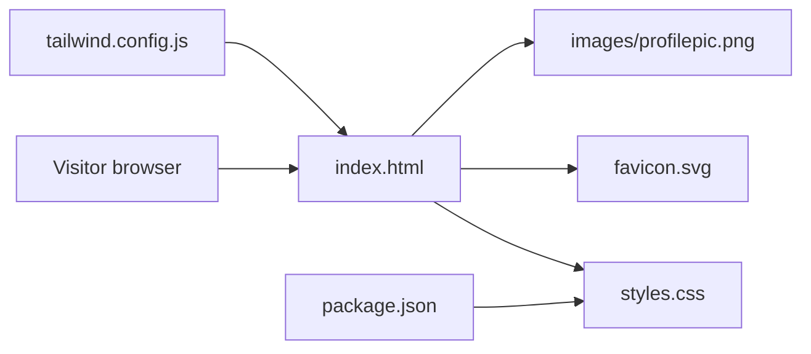

# Personal Portfolio Website

Source for [rishabhjain9196.github.io](https://rishabhjain9196.github.io), a responsive single-page portfolio website.


## Overview

The site is a static page built with HTML, CSS and vanilla JavaScript, and served by GitHub Pages. It has navigation, a profile introduction, an experience timeline, skills, education, mentorship, projects, achievements and contact links.

## Structure



| Path | Purpose |
| --- | --- |
| `index.html` | Main single-page portfolio content, navigation, sections and client-side interaction. |
| `styles.css` | Checked-in stylesheet used by the page. |
| `tailwind.config.js` | Tailwind configuration that scans `index.html` and enables class-based light mode styling. |
| `package.json` | Defines Tailwind build and watch scripts. |
| `favicon.svg` | Site icon. |
| `images/profilepic.png` | Profile image used in the page. |

## Features

- Responsive desktop and mobile navigation.
- Scroll reveal effects using `IntersectionObserver`.
- Sticky navigation styling that changes after scrolling.
- Animated counters for headline numbers.
- Light and dark themes, with the choice saved in `localStorage`.

## Run locally

Open `index.html` directly in a browser, or serve the folder locally:

```bash
python -m http.server 8000
```

Then visit `http://localhost:8000`.

## Build notes

The page uses the committed `styles.css`. The npm scripts build it with Tailwind from `src/input.css`, which is not in the repository, so add that file before rebuilding the stylesheet.
