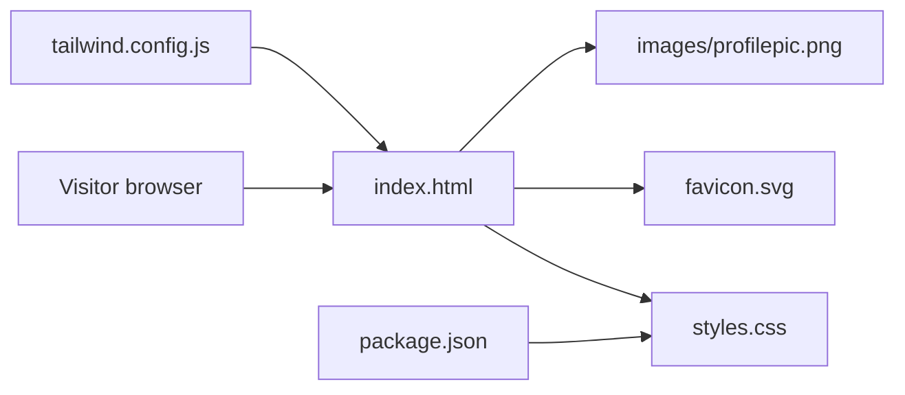

# Personal Portfolio Website

Source for [rishabhjain9196.github.io](https://rishabhjain9196.github.io), a responsive single-page portfolio website.


## Overview

The site is a static page built with HTML, CSS and vanilla JavaScript, and served by GitHub Pages. The introduction leads directly to three featured reports. Experience, skills, education, mentorship, earlier projects and achievements follow.

## Structure



| Path | Purpose |
| --- | --- |
| `index.html` | Main single-page portfolio content, navigation, sections and client-side interaction. |
| `styles.css` | Checked-in stylesheet used by the page. |
| `src/input.css` | Tailwind source used to regenerate the stylesheet. |
| `tailwind.config.js` | Tailwind configuration that scans `index.html` and enables class-based light mode styling. |
| `package.json` | Defines Tailwind build and watch scripts. |
| `favicon.svg` | Site icon. |
| `images/profilepic.webp` | Compressed portrait used in the page. The original PNG is retained as the source. |
| `images/og-preview.svg` | Editable source for the 1200 by 630 social preview. |
| `images/og-preview.png` | PNG social preview used by Open Graph and Twitter metadata. |

## Features

- Responsive desktop and mobile navigation.
- Scroll reveal effects using `IntersectionObserver`.
- Sticky navigation styling that changes after scrolling.
- Animated counters for headline numbers.
- Light and dark themes, with the choice saved in `localStorage`.
- The menu supports Escape, focus return and accessible expanded-state announcements.
- Content, navigation and final counter values remain available without JavaScript.
- Reduced-motion preferences disable animation, including when the preference changes during a visit.

## Run locally

Open `index.html` directly in a browser, or serve the folder locally:

```bash
python -m http.server 8000
```

Then visit `http://localhost:8000`.

## Build notes

The page uses the committed `styles.css`. After changing utility classes in `index.html`, rebuild it with the locked dependencies:

```bash
npm ci
npm run build
```

Commit both the HTML changes and regenerated stylesheet. `npm run dev` watches for changes while editing.

The WebP portrait was exported from the original 400 by 400 PNG at quality 85, retaining transparency. To update the social preview, edit the SVG and export it to PNG at 1200 by 630 pixels.

Before publishing, check navigation and card widths from 320 to 1366 pixels, both themes, keyboard menu controls, reduced motion, disabled JavaScript and blocked storage. Confirm that the social-preview image loads and that every local anchor resolves.
